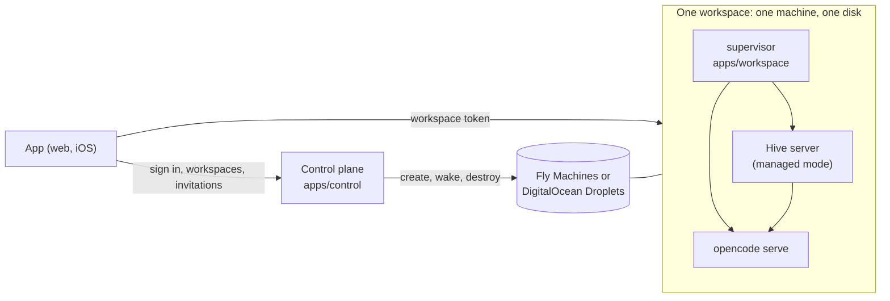
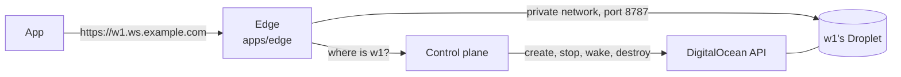
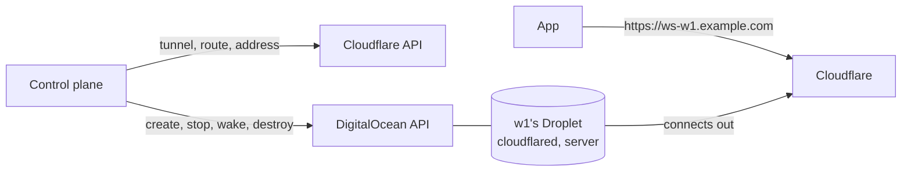

# Hosted workspaces

Hive can run as a service for many teams: people open the app, sign in once, make a workspace, invite their team and start working. Each workspace is a Hive of its own, on a machine and a disk of its own, started by a control plane. This page is how the pieces fit, how to run them on a laptop, how to deploy them to [Fly](https://fly.io) or to [DigitalOcean](https://www.digitalocean.com) (and the control plane to [Cloudflare](#deploy-the-control-plane-on-cloudflare)), and what has not been tried on a real account.

A single team that runs its own Hive on a VM does not need any of this: see [VM deploy](vm-deploy.md).

## How it fits together



- **The control plane** (`apps/control`) knows who people are (Google sign-in), which workspaces exist, who belongs to each and in what role, and which invitations are open. It keeps that in its own database, creates and removes workspaces through a *provisioner*, and signs a short-lived **workspace token** for a person who belongs to a workspace. Run as a Node process it serves the web app too, so there is one address to give people; run as a Cloudflare Worker it does not, and the web app is hosted separately.
- **A workspace** (`apps/workspace`) is one image: the Hive server in managed mode and OpenCode, started by a small supervisor. It has no sign-in of its own. It trusts the control plane's public key and nothing else about who a person is.
- **The provisioner** is where workspaces run, chosen with `PROVISIONER`: `fly` (Fly Machines), `digitalocean` (a Droplet each, reached through the edge or through a Cloudflare Tunnel each), or `local` (processes on the machine the control plane is on, for trying things out).
- **The app** is the same app that opens a self-hosted workspace. A build with `EXPO_PUBLIC_CONTROL_URL` set is the hosted app: it signs in at the control plane, lists the person's workspaces, and signs in to the one they open.

### Getting into a workspace

1. The person signs in at the control plane (Google). The app keeps the control plane's session (30 days) in the keychain on a phone and in `localStorage` on the web.
2. They open a workspace. The app asks the control plane to wake it (a stopped machine is started and waited for), then for a token: `POST /v1/workspaces/:id/token`. The control plane gives one only to a member, signed with its Ed25519 key: the workspace id (audience), the person's id, email, name and role, valid for 60 seconds.
3. The app gives the token to the workspace, `POST /api/auth/managed`. The workspace checks the signature against the control plane's public key and that the token is for this workspace and was not used before, and answers with a session of its own that lasts an hour, and when it ends.
4. The app signs in again before the hour is up, and when the workspace refuses a request, without the person seeing it. A person who has been removed gets no new token, so they lose access within the hour.

A workspace never has the control plane's private key or the person's Google account, only their name, email and role. Nothing a workspace holds passes through the control plane.

### What a workspace is made of

**On Fly**, each workspace is **an app of its own on a private network of its own**, so a machine cannot reach another workspace's. The app has a public address (`https://<prefix>-<id>.fly.dev`) with TLS handled by Fly, an encrypted volume mounted at `/data` that holds everything (the database, channel files, the agent's sessions, the secrets below), and one machine. The free plan stops the machine when nobody is using it and Fly's proxy starts it on the next request; the team plan keeps it running.

**On DigitalOcean**, each workspace is **a Droplet of its own**, made from one snapshot that has the workspace installed on it. The workspace runs on the machine itself, as a service (`apps/workspace/vm`), and not in a container, so **the whole disk is the workspace's**: its database and files in `/data`, the agent's home in `/home/hive`, and anything else installed or changed stays through a stop, a restart and a reboot. The Droplet is not public. A cloud firewall lets only the edge reach its port, and a firewall on the machine keeps what runs as the workspace's user away from the metadata service and the private network while leaving the internet open. The workspace's settings arrive in a file only root can read, written on first boot, and the service reads it before it gives up root.

**The agent can become root on its Droplet**, with `sudo` and no password, so a package it installs or a service it sets up is part of the machine and stays. It does not run as root, and neither does the server: they run as the workspace's user, and the agent asks for root when it needs it. The machine is the team's own, and root there reaches nothing of another team's, since the cloud firewall is outside the machine and no DigitalOcean credential is on it; but root can read the machine's settings, lift the machine's own firewall, change the workspace's code, or break the machine. [SECURITY.md](../SECURITY.md#hosted-workspaces) says what follows from that. To take sudo away, remove the sudoers lines from `apps/workspace/vm/bake.sh`, set `NoNewPrivileges=yes` in `apps/workspace/vm/hive-workspace.service`, and make the image again.

People reach a workspace at `https://<id>.<your workspace domain>`, which is the **edge** (`apps/edge`). It ends TLS with one wildcard certificate, so no key is on a workspace's machine; reads the workspace from the host name; asks the control plane where it is (`/internal/upstream/<id>`, with a token only the edge has); and passes the request on, streams and websockets included. It connects only to the address ranges it is told (the private network by default), whatever the control plane says, and it tells the workspace who the visitor is and takes away any claim a visitor makes about it.



A workspace makes its own secrets the first time it starts (`/data/secrets.json`: the key that encrypts credentials it stores, and the password the server uses to reach OpenCode). They are not passed in, so they exist nowhere else.

## Run it on a laptop

```sh
pnpm install
opencode serve --port 4096        # the agent, shared by the workspaces started below

# The app, built for the control plane's address
EXPO_PUBLIC_CONTROL_URL=http://localhost:8800 pnpm build:web

# The control plane, starting each workspace as a process on this machine
CONTROL_MODE=sample PROVISIONER=local \
CONTROL_WEB_DIR=apps/mobile/dist/web \
LOCAL_WORKSPACE_ENV='{"OPENCODE_SERVER_URL":"http://127.0.0.1:4096","MODEL":"openai/gpt-5"}' \
  pnpm exec tsx apps/control/src/index.ts
```

Open <http://localhost:8800>. A sample control plane (the default) lets anyone sign in with an email address and listens only on the loopback address; it is for trying things out. Each workspace is a Hive server on a port of its own, with its files under `.hive-control/workspaces/<id>/`. Give the model's provider key to `opencode serve` as for any Hive.

With `pnpm dev:web` instead of a build, start the control plane with `CONTROL_ALLOWED_ORIGINS=http://localhost:8081` (a sample control plane already allows it) and run `EXPO_PUBLIC_CONTROL_URL=http://localhost:8800 pnpm dev:web`.

## Deploy to Fly

You need a Fly organisation, `flyctl`, a Google OAuth client, and a model provider key.

**1. The workspace image.** Build it from the repository root, check it, and push it to a registry Fly can pull from. Fly's own registry works: create an app to hold images once, then push to it.

```sh
fly apps create hive-images          # any name that is free
docker build -f apps/workspace/Dockerfile -t registry.fly.io/hive-images:1 .
pnpm exec tsx apps/workspace/tests/run-docker.ts      # runs it as a machine would (needs Docker)
fly auth docker && docker push registry.fly.io/hive-images:1
```

`run-docker.ts` starts the image, signs a person in with a token it signs itself, checks that nothing runs as root, that the machine's settings hold none of the workspace's secrets, that it stops cleanly and that a restart keeps its data. Set `HIVE_IMAGE` to check an image you already built.

**2. Google.** Make an OAuth client of type *Web application* with the redirect URI `https://<your host>/v1/auth/google/callback`. The control plane asks for the scopes `openid email profile` only. (A workspace asks for a person's Gmail or Calendar itself, if it wants them; see [what is not built](#what-is-not-built).)

**3. The control plane.** Its image holds the server and the web app, which is built for the address people will use. Put this `fly.toml` at the repository root, with that address, and keep one machine running: it finishes workspaces that were being made when it restarted. Use a volume for its database, or set `CONTROL_DATABASE_URL` to a Postgres.

```toml
app = "hive-control"
[build]
  dockerfile = "apps/control/Dockerfile"
  [build.args]
    CONTROL_URL = "https://hive.example.com"
[http_service]
  internal_port = 8800
  force_https = true
  auto_stop_machines = "off"
  min_machines_running = 1
[mounts]
  source = "control_data"
  destination = "/data"
```

```sh
fly apps create hive-control && fly volumes create control_data -a hive-control --size 1
fly secrets set -a hive-control \
  CONTROL_MODE=live CONTROL_PUBLIC_URL=https://hive.example.com \
  CONTROL_CLIENT_IP_HEADER=Fly-Client-IP \
  GOOGLE_CLIENT_ID=… GOOGLE_CLIENT_SECRET=… \
  PROVISIONER=fly FLY_ORG=<org> FLY_IMAGE=registry.fly.io/hive-images:1 \
  FLY_API_TOKEN="$(fly tokens create org -o <org>)" \
  HIVE_WORKSPACE_ENV='{"MODEL":"openai/gpt-5","OPENAI_API_KEY":"…"}'
fly deploy
```

Point `hive.example.com` at the app (`fly certs add hive.example.com -a hive-control`), and add that address as an authorised redirect in the Google client.

**4. Try it on the real account** before anyone else does, with the spike tool:

```sh
FLY_API_TOKEN=… FLY_ORG=… FLY_IMAGE=registry.fly.io/hive-images:1 \
  pnpm exec tsx apps/control/tools/fly-spike.ts
```

It makes one workspace, then reports how long each step takes: creating it (app, addresses, volume, machine, first answer), a second `create` that must come back with the same address, signing in and keeping a channel, a request to the address after the machine was stopped (Fly's autostart), being woken by the control plane, and whether the channel survived the stop. Then it destroys the workspace and checks nothing is left. It exits non-zero if a step fails, and cleans up either way (`--keep` leaves the workspace to look at). The numbers are what to expect on your account; write them down. Failures usually name the cause: a token without rights to create apps, an organisation slug that is not the one Fly shows, an image Fly cannot pull, or a machine that starts and stops again (read `fly logs -a hive-<id>`).

### Backups

Fly snapshots a volume every day and keeps them for 60 days, which is as long as it allows. A volume lives on one host, so those snapshots are the only copy: copy them somewhere else before charging anyone. To restore, make a volume from a snapshot and start a machine on it:

```sh
fly volumes snapshots list -a hive-<id>
fly volumes create data -a hive-<id> --snapshot-id <snapshot> --region iad
```

## Deploy to DigitalOcean

You need a DigitalOcean account and an API token with read and write access, Docker, a registry to push the workspace image to, a domain for workspaces, a Google OAuth client, and a model provider key. The control plane can run anywhere: on Fly as above, or on a Droplet.

**1. The workspace image.** The image is the one Fly uses; the Droplets' image is made from it.

```sh
docker build -f apps/workspace/Dockerfile -t ghcr.io/you/hive-workspace:2026-10 .
pnpm exec tsx apps/workspace/tests/run-docker.ts     # optional: runs it as a container would
docker push ghcr.io/you/hive-workspace:2026-10
```

No Docker on hand? The workflow `.github/workflows/workspace-image.yml` builds the same image on GitHub and pushes it to `ghcr.io/<owner>/hive-workspace:sha-<commit>` whenever the image's files change on `collab` or `main` (and from the Actions tab once the file is on the default branch, with a tag of your choosing). The run's summary prints the image and the command for step 2. A package it publishes is private until you change it under the package's settings; a private one needs `HIVE_REGISTRY_USER` and a classic personal access token with only `read:packages` as `HIVE_REGISTRY_TOKEN`.

**2. The Droplet image.** One command makes the snapshot every workspace's Droplet starts from:

```sh
DO_API_TOKEN=… HIVE_REGISTRY_USER=… HIVE_REGISTRY_TOKEN=… \
  pnpm exec tsx apps/control/tools/do-image.ts --image ghcr.io/you/hive-workspace:2026-10 --region nyc3
```

It starts a Droplet from Ubuntu 24.04 and sends it `apps/workspace/vm/bake.sh` with the service and firewall files beside it. The Droplet installs packages, takes the workspace out of the container image, starts a workspace once to see that it does, and switches itself off. The tool then snapshots it, deletes the Droplet, and prints `DO_IMAGE=<id>`. It takes 10 to 20 minutes. The registry login is for a private image only: give it a token that can pull and nothing else, since it is on the Droplet while the image is made. If anything goes wrong the Droplet is left running with its log in `/var/log/hive-bake.log`, and the message says how to remove it.

A snapshot is in the region it was made in; transfer it to use another. It can only go on a Droplet whose disk is as big as the one it was made on, so the tool makes it on the smallest disk that has the memory (`--size` names one).

`pnpm exec tsx apps/workspace/tests/run-vm.ts` runs the same scripts in a container that runs systemd, starts a machine from the result the way a Droplet starts, and checks it: that it waits without settings, answers once it has them, runs nothing of the workspace's as root, lets the agent become root and keeps what it installs, with the workspace's data, across a reboot, stops the server before the agent, and has the firewall described above. It needs a Docker that runs privileged containers.

**3. A domain and a certificate.** *(Skip steps 3 and 4 if workspaces are reached through [Cloudflare Tunnels](#reaching-workspaces-through-cloudflare-tunnels-no-edge) instead of the edge.)* Workspaces share a parent domain, so give them one that serves nothing else, such as `ws.example.com`, and not a subdomain of the control plane's. Point `*.ws.example.com` at the edge's public address and get a wildcard certificate by DNS validation, for example with certbot and DigitalOcean's DNS:

```sh
certbot certonly --dns-digitalocean --dns-digitalocean-credentials /root/do.ini -d '*.ws.example.com'
```

**4. The edge.** Run it on a Droplet in the same region and private network as the workspaces, with the tag `hive-edge`, which is what the workspaces' firewall lets in. It is a small program, and the smallest Droplet will do for a while. The edge runs as an unprivileged user, so give it copies of the certificate that it can read, renewed by a hook:

```sh
install -d -m 0750 -g 1000 /etc/hive-edge
cat > /etc/letsencrypt/renewal-hooks/deploy/hive-edge <<'EOF'
#!/bin/sh
install -m 0644 "$RENEWED_LINEAGE/fullchain.pem" /etc/hive-edge/cert.pem
install -m 0640 -g 1000 "$RENEWED_LINEAGE/privkey.pem" /etc/hive-edge/key.pem
EOF
chmod +x /etc/letsencrypt/renewal-hooks/deploy/hive-edge
RENEWED_LINEAGE=/etc/letsencrypt/live/ws.example.com /etc/letsencrypt/renewal-hooks/deploy/hive-edge

export EDGE_TOKEN="$(openssl rand -hex 32)"          # the control plane is given the same value
docker build -f apps/edge/Dockerfile -t hive-edge .
docker run -d --name hive-edge --restart unless-stopped -p 443:443 -p 80:80 -v /etc/hive-edge:/certs:ro \
  -e EDGE_DOMAIN=ws.example.com -e EDGE_CONTROL_URL=https://hive.example.com -e EDGE_TOKEN \
  -e EDGE_TLS_CERT=/certs/cert.pem -e EDGE_TLS_KEY=/certs/key.pem hive-edge
```

`https://anything.ws.example.com/__edge/health` answers `{"ok":true}` when it is up, whatever name is asked for. It looks at the certificate files every five minutes and serves a renewed one without a restart. Port 80 sends people to https.

**5. The control plane.** As for Fly, with these settings in place of Fly's:

```sh
fly secrets set -a hive-control \
  PROVISIONER=digitalocean DO_API_TOKEN=… DO_IMAGE=<the id from step 2> \
  DO_PUBLIC_URL_TEMPLATE='https://{id}.ws.example.com' DO_REGION=nyc3 \
  CONTROL_EDGE_TOKEN="$EDGE_TOKEN" \
  HIVE_WORKSPACE_ENV='{"MODEL":"openai/gpt-5","OPENAI_API_KEY":"…"}'
```

If the edge is not on a Droplet that carries the `hive-edge` tag, name its address instead with `DO_EDGE_ADDRESSES`. The first workspace made also makes the firewall `hive-workspaces`, which allows the workspace's port from the edge and nothing else in; one that already exists is left as it is.

**6. Try it on the real account** before anyone else does, with the spike tool:

```sh
DO_API_TOKEN=… DO_IMAGE=<the id from step 2> DO_EDGE_ADDRESSES="$(curl -s https://api.ipify.org)/32" \
  pnpm exec tsx apps/control/tools/do-spike.ts
```

It makes one workspace under names of its own (`hivespike-…`, so it touches nothing of a deployment's), with a firewall that opens the workspace's port to this machine. It waits for the workspace at the Droplet's own address, so it needs no edge or control plane. It reports how long it takes to create, stop and wake the workspace, whether the firewall keeps ssh out, whether what the workspace kept survived the stop, how many calls it made to DigitalOcean against the 5,000 an hour that it allows, and whether anything is left. It exits non-zero if a step fails and cleans up either way (`--keep` leaves the Droplet to look at).

### Reaching workspaces through Cloudflare Tunnels (no edge)

With `DO_ACCESS=tunnel` the control plane gives each workspace a [Cloudflare Tunnel](https://developers.cloudflare.com/cloudflare-one/networks/connectors/cloudflare-tunnel/) of its own, and there is nothing to run in front of the Droplets: no edge Droplet, no wildcard certificate to renew, no address ranges to allow. Each Droplet runs `cloudflared` (it is in the image from step 2) with its tunnel's token, which connects *out* to Cloudflare. Cloudflare holds the certificate for the workspace's address and sends the address down that connection to the server, which listens on the Droplet's `127.0.0.1` and nowhere else. The Droplets' cloud firewall lets nothing in.



Making a workspace does three things, each safe to repeat. It makes a tunnel named `hive-ws-<id>`, with its routes kept by Cloudflare: the workspace's address goes to `http://localhost:8787` and anything else gets a 404. It points the address at the tunnel with a proxied DNS record, and will not change a record at that name that is not a tunnel's. And it makes the Droplet, giving it the tunnel's token in a file only root can read, `/etc/hive/tunnel-token`, apart from the workspace's settings, which the workspace's processes are given. It then waits for the workspace to answer at its address, which it does once the Droplet's `cloudflared` has connected. Removing a workspace deletes the Droplet, then the address, the tunnel's connections, and the tunnel.

To set it up:

1. **The domain's DNS is on Cloudflare**, and workspaces get one-level names: `DO_PUBLIC_URL_TEMPLATE='https://ws-{id}.example.com'`. Cloudflare's free certificate covers `example.com` and the names directly under it, and [not deeper ones](https://developers.cloudflare.com/ssl/edge-certificates/universal-ssl/limitations/) such as `{id}.ws.example.com`, which need Advanced Certificate Manager.
2. **An API token** (Cloudflare dashboard, My Profile, API Tokens) with *Account, Cloudflare Tunnel, Edit* and *Zone, DNS, Edit* for that one zone, and the account id and the zone id (on the zone's overview page).
3. **Make the Droplet image again** (step 2): this version of `bake.sh` puts `cloudflared` on it, a pinned release checked against its checksum. One image serves both ways of reaching a workspace.
4. **Settings for the control plane**, in place of the edge's: `DO_ACCESS=tunnel`, `DO_PUBLIC_URL_TEMPLATE`, and `CLOUDFLARE_API_TOKEN`, `CLOUDFLARE_ACCOUNT_ID`, `CLOUDFLARE_ZONE_ID`. `CONTROL_EDGE_TOKEN` is not needed, and `DO_READY_CHECK=droplet` is refused, since nothing listens on the Droplet's network.
5. **If the account already has the firewall `hive-workspaces`** from reaching workspaces through the edge, delete it: a firewall that exists is left as it is, and that one lets the edge in. The first workspace made then makes one with no inbound rule.

What to know:

- **Cloudflare allows 1,000 tunnels per account** ([account limits](https://developers.cloudflare.com/cloudflare-one/account-limits/)), and a workspace takes one, so a deployment on one account tops out at about a thousand workspaces unless Cloudflare raises it for you. Past that the edge is the way, since it needs no tunnel. How many DNS records a zone may have on your plan has not been looked up.
- **Cloudflare's limits are the workspace's**: the size of a request body (100 MB on the Free and Pro plans) and how long a proxied request may take to begin its answer (about 100 seconds before Cloudflare gives up with a 524). The workspace's streams and websockets are not affected by the second.
- **HSTS.** The edge added `Strict-Transport-Security`; Cloudflare does not unless you turn it on (SSL/TLS, Edge Certificates).
- **The visitor's address.** Cloudflare adds `CF-Connecting-IP` to what reaches the workspace. Nothing in the workspace server reads a forwarded address today.
- **Who holds the token.** Whoever has a tunnel's token can run the other end of that workspace's tunnel and so receive its traffic. It is on the Droplet in a file only root reads (and the agent can be root there), in the Droplet's first-boot data, and in the control plane's memory while it makes the workspace. A leaked token is replaced by deleting the tunnel, which removing the workspace does.
- `do-spike.ts` still tries the edge's way of reaching a workspace, and does not try tunnels.

### Size, cost and limits

Both plans run on the cheapest available shared size with 2 vCPUs, 4 GB, and room for the plan's disk; `DO_SIZE`, or `DO_SIZE_FREE` and `DO_SIZE_TEAM`, name one instead. A workspace uses about 0.75 GB idle, before any task runs, so 2 GB is the least that works. DigitalOcean bills a Droplet by the hour for as long as it exists, whether it is on or off, so stopping one saves nothing and **no plan stops an idle workspace there**: the free plan costs what the team plan does.

The limits are DigitalOcean's: Droplets per account (ask them to raise it), and 5,000 API calls an hour per token. Creating a workspace takes a few calls and then one every few seconds while the Droplet starts, a wake the same without the setup, and the edge's questions take none, since the control plane remembers a running workspace's address for five minutes. The spike reports the real numbers.

### Updates and backups

A new snapshot is used by workspaces made after it. A Droplet that exists is not changed: Ubuntu installs security updates on it by itself but does not restart it, so restart a Droplet now and then to take a new kernel. Rolling a new workspace version onto existing Droplets is not written.

Hive makes no copy of a workspace's disk itself. A Droplet can be lost with its host, and its data with it. Set `DO_BACKUPS=on` and DigitalOcean backs up each new workspace's Droplet weekly, keeping the last four, for a fifth of the Droplet's price extra (the hosted site sets it). There is no restore button in Hive: to bring a workspace back, restore the backup in the DigitalOcean console (Backups, then Restore) onto the same Droplet. A backup belongs to its Droplet and goes with it, so it is not a way to undelete a workspace, and Droplets made before the setting was on have none (turn them on in the console). Keep a copy somewhere that is not DigitalOcean before charging anyone.

## Deploy the control plane on Cloudflare

The control plane can run as a Cloudflare Worker (`apps/control/src/worker.ts`) instead of a Node process. It is the same app with the same rules, with its records in [D1](https://developers.cloudflare.com/d1/) (Cloudflare's SQLite), its sign-in limit shared by every copy, and workspaces made by a [Workflow](https://developers.cloudflare.com/workflows/). There is no machine to size or keep running: Cloudflare runs as many copies as there is traffic. Workspaces still run on Fly or DigitalOcean; this moves only the control plane.

What is different from the Node server:

- **Records** are in D1 (`apps/control/src/d1-store.ts`, schema in `apps/control/migrations`). The Node server keeps using Postgres (embedded or `CONTROL_DATABASE_URL`).
- **Making a workspace** is not done in the request, which ends when it answers. `POST /v1/workspaces` records the workspace as `provisioning` and starts a Workflow (`ProvisionWorkspace`), which runs the provisioner (up to 15 minutes an attempt, three retries). A timer every minute starts anything no one is making and finishes removals that did not finish.
- **Several copies at once.** Before a copy calls the provisioner it claims the workspace's 20-minute lease in D1, so a workspace is made once even when the request, the timer and a retry all start it, and a delete waits for a copy that is still making it.
- **The sign-in limit** is a Cloudflare [rate limit binding](https://developers.cloudflare.com/workers/runtime-apis/bindings/rate-limit/) (20 attempts a minute per visitor, from `CF-Connecting-IP`). Cloudflare's own documentation says its counts are approximate and kept per location, so treat it as a brake and not an exact count.
- **The web app is not served by the Worker.** It is static files: build it with `EXPO_PUBLIC_CONTROL_URL` set to the Worker's address and put it on Cloudflare (or anywhere), and list its address in `CONTROL_ALLOWED_ORIGINS`. `CONTROL_WEB_DIR` is for the Node server only. On Cloudflare it is a Worker with static assets, set up by `apps/mobile/wrangler.jsonc` (name `hive-app`, address `app.vi-ak.com`): run `EXPO_PUBLIC_CONTROL_URL=https://api.vi-ak.com pnpm build:web`, then `npx wrangler deploy` from `apps/mobile`. Its `single-page-application` fallback serves `index.html` for paths with no file, which an invite link (`/join/<token>`) needs. Wrangler's `pages` commands now create this kind of Worker too, from the folder they run in, and write a `wrangler.jsonc` there without a fallback, so use `wrangler deploy` with the config in the repo.
- **Settings** are the variables under [Configuration](#the-control-plane), as `vars` in `wrangler.jsonc` and secrets. Not used: `CONTROL_PORT`, `CONTROL_HOST`, `CONTROL_DATA_DIR`, `CONTROL_DATABASE_URL`, `CONTROL_WEB_DIR`. **`CONTROL_SIGNING_KEY` is required**, since a Worker has nowhere to keep a key and every copy must sign alike. `PROVISIONER` is `fly` or `digitalocean`; `local` starts processes and cannot run in a Worker.

To deploy, from `apps/control`:

```sh
wrangler d1 create hive-control                          # put the database_id it prints in wrangler.jsonc
wrangler d1 migrations apply hive-control --remote
# In wrangler.jsonc: the route (api.vi-ak.com is an example, use your own), CONTROL_PUBLIC_URL,
# CONTROL_ALLOWED_ORIGINS (the web app's address), GOOGLE_CLIENT_ID, PROVISIONER and the
# provider's settings that are not secret (DO_IMAGE, DO_REGIONS, CLOUDFLARE_ACCOUNT_ID, CLOUDFLARE_ZONE_ID, ...).
wrangler deploy
node -e 'console.log(require("node:crypto").generateKeyPairSync("ed25519").privateKey.export({type:"pkcs8",format:"der"}).toString("base64url"))' \
  | wrangler secret put CONTROL_SIGNING_KEY               # once; replacing it locks every workspace out
wrangler secret put GOOGLE_CLIENT_SECRET
wrangler secret put DO_API_TOKEN                          # or FLY_API_TOKEN
wrangler secret put CLOUDFLARE_API_TOKEN                  # for tunnels, below
```

The Worker answers with an error until the signing key is set. Add `<CONTROL_PUBLIC_URL>/v1/auth/google/callback` to the Google OAuth client's redirect URIs. On DigitalOcean, either reach workspaces through [Cloudflare Tunnels](#reaching-workspaces-through-cloudflare-tunnels-no-edge), which `wrangler.jsonc` is set up for and which leaves nothing else to run, or keep the [edge](#the-edge-appsedge) as its own process: set its `EDGE_CONTROL_URL` to the Worker's address, and give the Worker (`wrangler secret put CONTROL_EDGE_TOKEN`) the token the edge has as `EDGE_TOKEN`.

**What has been checked.** The Worker runs in `workerd` (`wrangler dev`, locally) in front of a stand-in DigitalOcean and a stand-in workspace: sign-in, creating a workspace through the Workflow (one Droplet), a workspace token signed in `workerd` and verified in Node, invitations and members (the queries run on `workerd`'s own SQLite), the sign-in limit refusing the 21st attempt, the timer, and deleting. `wrangler deploy --dry-run` accepts `wrangler.jsonc` (a 934 KiB bundle, 160 KiB compressed). The control plane's tests also pass against D1 (`pnpm test:control-d1`, which runs them over Node's SQLite with the real migration), including a pair of copies sharing one store.

**What has not.** Nothing has been deployed to a Cloudflare account. Unmeasured: how the Workflows service behaves for a step that runs for minutes or is retried, D1's latency and limits from the edge, the rate limit at real traffic, the custom domain, what a request costs in CPU time against your plan's limit, and which plan Workflows, D1 and a cron trigger need and what they cost. The local test used `workerd` and not Cloudflare's network, and no real Google sign-in has run.

## Configuration

### The control plane

| Variable | Meaning |
| --- | --- |
| `CONTROL_MODE` | `sample` (default): anyone signs in by email, loopback only. `live`: Google sign-in, an https address, and a host that people can reach. |
| `CONTROL_PUBLIC_URL` | Where people reach it. Invitation links are made from it and every workspace allows its origin. Must be https in live mode. Default `http://localhost:<port>`. |
| `CONTROL_PORT` / `CONTROL_HOST` | Default 8800 and 127.0.0.1 (use 0.0.0.0 in a container). |
| `CONTROL_DATA_DIR` | Its database and signing key (default `.hive-control`). |
| `CONTROL_DATABASE_URL` | A Postgres to use instead of the embedded database in the data directory. |
| `CONTROL_SIGNING_KEY` | The Ed25519 key it signs workspace tokens with (base64url PKCS8). Without it one is made on first start and kept in the data directory. Replacing the key locks every workspace out. |
| `CONTROL_WEB_DIR` | The web export to serve, from `pnpm build:web` made with `EXPO_PUBLIC_CONTROL_URL`. |
| `CONTROL_ALLOWED_ORIGINS` | Web origins besides `CONTROL_PUBLIC_URL` that may call the API; also allowed by every workspace. |
| `CONTROL_MAX_WORKSPACES` | How many workspaces one person can be in, made or joined (default 3; the hosted site sets 1). A refused join does not use up the invitation. |
| `CONTROL_CLIENT_IP_HEADER` | The header the host's proxy puts the visitor's address in (`Fly-Client-IP` on Fly). Sign-in limits count per visitor, and without it every visitor looks like the proxy. |
| `GOOGLE_CLIENT_ID` / `GOOGLE_CLIENT_SECRET` | The OAuth client people sign in with. Required in live mode. |
| `CONTROL_EDGE_TOKEN` | At least 32 characters. What the edge shows to ask where a workspace is (`GET /internal/upstream/:id`); the route does not exist without it. |
| `PROVISIONER` | `fly`, `digitalocean` or `local`. |

### Fly (`PROVISIONER=fly`)

| Variable | Meaning |
| --- | --- |
| `FLY_API_TOKEN` | An organisation token that can create apps, volumes and machines. |
| `FLY_ORG` | The organisation's slug. |
| `FLY_IMAGE` | The workspace image, tag included. |
| `FLY_REGION` | Where workspaces run (default `iad`). |
| `FLY_APP_PREFIX` | Put before the workspace id to name its app (default `hive`). |
| `HIVE_WORKSPACE_ENV` | A JSON object of settings every workspace gets: `MODEL`, and the provider key. |
| `FLY_API_URL`, `FLY_PUBLIC_URL_TEMPLATE`, `FLY_WAIT_SECONDS` | The Machines API, where a workspace answers (`https://{app}.fly.dev`), and how long to wait for one (180). |

### DigitalOcean (`PROVISIONER=digitalocean`)

| Variable | Meaning |
| --- | --- |
| `DO_API_TOKEN` | A token that can create and delete Droplets and firewalls and read sizes and images. |
| `DO_IMAGE` | The snapshot every workspace's Droplet is made from: the id `do-image.ts` printed. |
| `DO_PUBLIC_URL_TEMPLATE` | Where people reach a workspace, an https address with `{id}` where its id goes (`https://{id}.ws.example.com`). |
| `DO_REGIONS` | Where workspaces may run, most wanted first (`nyc3,tor1,ric1`): a new workspace goes to the first with a size for it and the image. Every minute the control plane copies the image to the ones that lack it (a few minutes each), so a region at capacity does not stop new workspaces; if none has room it keeps trying for 15 minutes before saying so. A workspace stays in the region it was made in. Cannot be used with `DO_VPC_UUID` and more than one region. |
| `DO_BACKUPS` | `on` to have DigitalOcean back up each new workspace's Droplet weekly (default off). |
| `DO_REGION` | One region, when `DO_REGIONS` is not set (default `nyc3`). The image must be in it. |
| `DO_SIZE`, `DO_SIZE_FREE`, `DO_SIZE_TEAM` | A size slug for every plan, or for one. Without one, the cheapest available shared size that fits the plan. |
| `DO_VPC_UUID` | The private network to put Droplets in (the region's default when unset). The edge must be in it. |
| `DO_SSH_KEYS` | SSH keys, by id or fingerprint, that can log in to a workspace's Droplet. None by default; the firewall does not open ssh either. |
| `DO_NAME_PREFIX` | Put before the workspace id to name its Droplet and tags (default `hive`). |
| `DO_FIREWALL` | `off` if you manage the firewall yourself. |
| `DO_EDGE_TAG`, `DO_EDGE_ADDRESSES` | What the firewall lets in: Droplets with this tag (default `hive-edge`), and addresses (CIDR, comma separated) for an edge that is not a Droplet of this account. |
| `DO_UPSTREAM_NETWORK` | `private` (default) or `public`: which of a Droplet's addresses the edge connects to. |
| `DO_READY_CHECK` | `public` (default): a new or waking workspace is waited for at its public address, through the edge (or the tunnel). `droplet`: at the Droplet's own address, for a control plane on the same network; not with `DO_ACCESS=tunnel`. |
| `DO_ACCESS` | `edge` (default): workspaces are reached through the edge. `tunnel`: through a [Cloudflare Tunnel](#reaching-workspaces-through-cloudflare-tunnels-no-edge) each, with no edge and nothing let in. |
| `CLOUDFLARE_API_TOKEN`, `CLOUDFLARE_ACCOUNT_ID`, `CLOUDFLARE_ZONE_ID` | With `DO_ACCESS=tunnel`, all three: a token that can edit tunnels on the account and DNS on the zone, and the account and the zone the workspaces' addresses are in. |
| `CLOUDFLARE_API_URL` | Cloudflare's API (`https://api.cloudflare.com/client/v4`), or a stand-in for it. |
| `HIVE_WORKSPACE_ENV` | A JSON object of settings every workspace gets: `MODEL`, and the provider key. |
| `DO_API_URL`, `DO_WAIT_SECONDS` | The API, and how long to wait for a workspace to answer (300). |

### The edge (`apps/edge`)

| Variable | Meaning |
| --- | --- |
| `EDGE_DOMAIN` | The domain workspaces are under: a workspace is reached at `<id>.<domain>`. |
| `EDGE_CONTROL_URL` | The control plane, which says where a workspace is. |
| `EDGE_TOKEN` | At least 32 characters; the control plane's `CONTROL_EDGE_TOKEN`. |
| `EDGE_TLS_CERT`, `EDGE_TLS_KEY` | The certificate for `*.<domain>` and its key, as PEM files. Or `EDGE_TLS=off`, to speak plain http behind something that ends TLS (it then carries on the `X-Forwarded-For` chain). |
| `EDGE_HTTPS_PORT`, `EDGE_HTTP_PORT`, `EDGE_HOST` | Where it listens (443, 80, all addresses; the http port only sends people to https, and `off` turns it off). |
| `EDGE_UPSTREAM_ALLOW` | The IPv4 ranges (CIDR, comma separated) a workspace may be at; it connects nowhere else. The private ranges by default. |
| `EDGE_CACHE_SECONDS`, `EDGE_NEGATIVE_SECONDS` | How long where a workspace is stays believed (60), and how long that a name is unknown or stopped does (3). |
| `EDGE_HEADERS_TIMEOUT_SECONDS`, `EDGE_CONNECT_TIMEOUT_SECONDS` | How long a workspace gets to begin its answer (120) and to accept a connection (5). |
| `EDGE_RELOAD_SECONDS` | How often the certificate files are looked at for a renewal (300). |

### Local (`PROVISIONER=local`)

`LOCAL_DIR` (where each workspace keeps its files), `LOCAL_COMMAND` and `LOCAL_CWD` (how to start one; the default runs the server from this checkout), `LOCAL_WORKSPACE_ENV` (a JSON object of settings every workspace gets: `OPENCODE_SERVER_URL`, `MODEL`), `LOCAL_WAIT_SECONDS`. A workspace gets only what it needs of the control plane's environment, so the signing key and Google secret never reach one.

### What the control plane gives each workspace

`WORKSPACE_MODE=live`, `WORKSPACE_ID`, `CONTROL_PLANE_PUBLIC_KEY`, `PUBLIC_API_URL` (its address), `ALLOWED_ORIGINS` (the control plane's, so the web app can call it), `HOST=0.0.0.0`, `PORT=8787`, `DATA_DIR=/data/hive`, and `HIVE_WORKSPACE_ENV`. The image's supervisor adds `TOKEN_ENCRYPTION_KEY` and the OpenCode password from the workspace's own secrets.

## Plans

`apps/control/src/plans.ts` is where a plan is defined: the machine, the disk, and whether the machine stops when it is idle. Every workspace is `free` today (2 shared CPUs, 4 GB, a 5 GB volume, stopped when idle); `team` is the same machine kept running with a 20 GB volume. Nothing bills yet.

A stopped machine does nothing, and Fly decides a machine is idle from the requests it is serving, not from the work it is doing. **Work that is meant to finish while nobody has the app open (a delegated task, say) can be cut short on a plan that stops when idle.** Until a workspace keeps itself awake while its agent is working, give such a team the `team` plan, which is always on. Fly bills a running machine by the second and a volume for as long as it exists, so a stopped workspace costs little but is not free. A Droplet on DigitalOcean costs the same off as on, so nothing there stops when idle; see [size, cost and limits](#size-cost-and-limits).

## Who can do what

The control plane decides. An **owner** (who made the workspace) can invite admins and members, change roles, remove anyone, retry a workspace that failed to start, and delete it. An **admin** can invite members and remove members. A **member** can leave. Invitations are a link anyone can use (50 uses, 7 days) or one for a single email address (1 use, 7 days). A person who is not in a workspace gets "not found" for it, not "forbidden".

A workspace stores the role it was told, but does not yet use it: inside a workspace everyone who is let in can do what any member of a self-hosted Hive can (see the [roadmap](../ROADMAP.md)).

## What is not built

- **Billing.** There is no payment, and the plans are not enforced.
- **A model the platform pays for, safely.** `HIVE_WORKSPACE_ENV` puts the provider key in each workspace, where the agent's shell and any member can read it. Use a key with a spend limit, and one per workspace if you can, until the key lives in a gateway the workspaces call.
- **Gmail and Calendar in a hosted workspace.** A workspace connects Google on its own address, and an OAuth client lists a fixed set of redirect URIs, not one per workspace. It needs the connection to go through the control plane.
- **Email.** Invitations for an address are made but not sent: the control plane prints them, and the person who invites shares the link. `apps/control/src/mailer.ts` is the interface to implement.
- **Staying awake while the agent works.** See [Plans](#plans): a workspace that stops when idle can stop in the middle of a task.
- **Updating a running workspace to a new image.** Creating is repeatable; rolling a fix out to existing workspaces, machines or Droplets, is not written.
- **Sleeping idle workspaces on DigitalOcean.** A Droplet costs the same off as on, so the only way to stop paying for one is to delete it. To keep a team's data, it would be snapshotted first (a snapshot is a saved copy of the Droplet's whole disk, and costs only the storage it takes), deleted, and made again from the snapshot when someone returns, which takes minutes and not seconds. Until then every workspace there is always on.
- **Backups of a workspace's disk**, on either host. See [updates and backups](#updates-and-backups).
- **TLS between the edge and a workspace.** (Not with tunnels, where the Droplet connects out and the server listens on 127.0.0.1.) The edge speaks plain http to a Droplet over the private network. The agent can be root on its Droplet, so a workspace's neighbours on that network matter: DigitalOcean's private networks are meant to keep one Droplet from seeing another's traffic or posing as it, and that has not been tried here.
- **Apple's rules.** Whether and how the app may sell or sign people in on iOS has not been checked, and nothing here builds a signed binary or a Mac app.
- **Roles inside a workspace, per-person limits, and cleaning up expired records** (sessions, login codes, sign-in states) in the control plane's database.

## Verification

See [Verification](VERIFICATION.md#coverage) for what the tests cover and what has only been checked against a stand-in.
